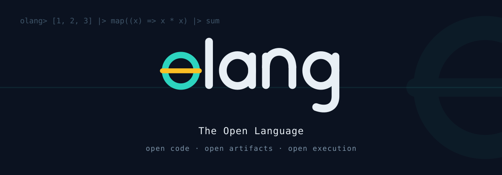

<p align="center">
  
</p>

# olang

olang is a dynamically typed, functional programming language implemented in
Rust: first-class functions, pipelines, pattern matching, algebraic data
types, immutable values and gradual typing, run on an interpreter, a bytecode
VM and a JIT that always agree. It ships with a large standard library,
including a native data stack (data frames, statistics, machine learning,
charts), thread-based parallelism without a global interpreter lock, a
browser runtime, and a toolchain for testing, formatting, checking, profiling
and building programs.

```olang
type Shape = enum { Circle(Float), Rect(Float, Float) }

fn area(s) = match s {
    Circle(r) => 3.14159 * r * r,
    Rect(w, h) => w * h
}

let total = [Circle(1.0), Rect(2.0, 3.0), Circle(0.5)]
    |> map(area)
    |> sum

println(`total area: ${total}`)
```

```olang
use ods { col }

let sales = ods.frame({
    region: ["east", "west", "east", "west"],
    amount: [25.5, 320.0, 80.0, 40.0],
})
let summary = sales
    .group_by("region")
    .agg({ revenue: col("amount").sum(), orders: ods.count() })
    .sort_by("revenue", descending: true)
println(summary)
```

## Installation

On a Mac, open Terminal, paste this line and press Return. It needs no
Rust and no administrator password:

```bash
curl -fsSL https://raw.githubusercontent.com/ooyeku/olang/main/install.sh | sh
```

Then open a new Terminal window and run `olang --version`. With
Homebrew, `brew install ooyeku/olang/olang` works too. Linux binaries are
an unsupported preview; on Windows, run the installer inside
[WSL](https://learn.microsoft.com/windows/wsl/install).
[Installation](docs/installation.md) covers every route, building from
source, and what to do when something goes wrong. Then:

```bash
olang script.ol            # run a program; arguments reach os.args()
olang                      # start the REPL
olang test                 # run test blocks under the current directory
olang check                # report provable type violations
otc new myapp              # scaffold a project
```

## Documentation

[The olang book](docs/README.md) is the documentation. Start with the
[Introduction](docs/introduction.md) and [A tour of olang](docs/tour.md);
then the [language reference](docs/language.md), the
[standard library](docs/stdlib.md), [the data stack](docs/ods.md), and
[the command line](docs/tooling.md). [Stability and
compatibility](docs/stability.md) states what is promised. Every olang code
block in the book and in this file is executed by the test suite.

## Examples

[`examples/`](examples/) holds complete programs: command-line tools, a
template engine, a regular-expression engine, a Lisp interpreter written in
olang, HTTP services, a full-stack issue tracker whose frontend runs in the
browser, data analyses, and a long-running harbor-operations simulator
([`concurrency/demo/`](examples/concurrency/demo/)). `cd examples && olang
run_all.ol` runs them all.

## License

MIT

<p align="center">
  <br>
  <sub>Ollie, the olang otter</sub>
</p>
